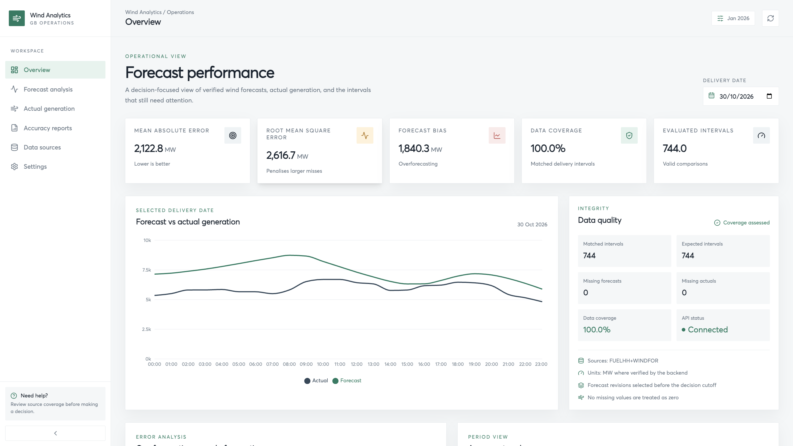
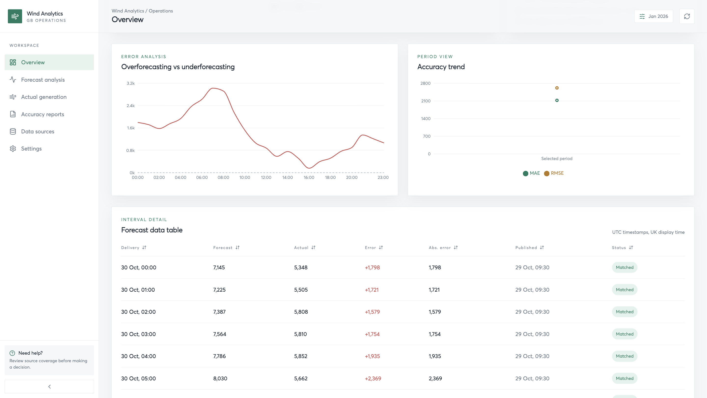
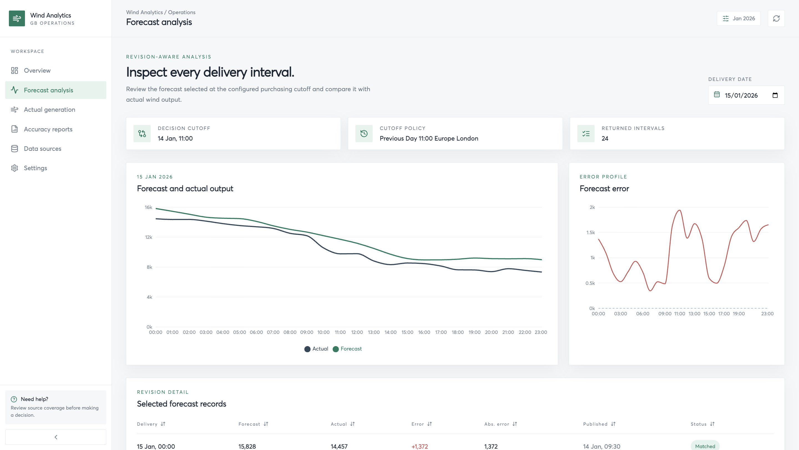
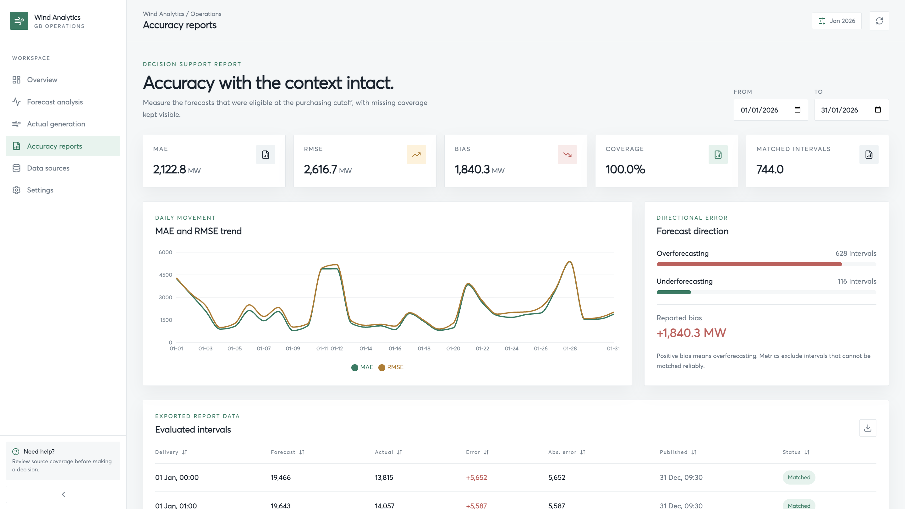
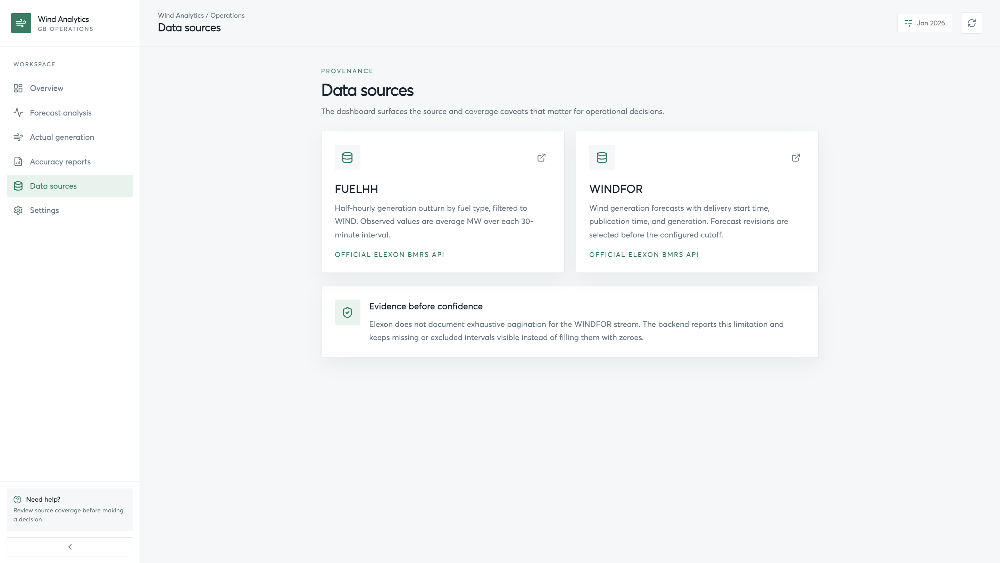

# Wind Analytics Dashboard

A focused Next.js dashboard for exploring wind-power forecasts, actual generation, delivery-date performance, and forecast accuracy. It is the frontend for the FastAPI service in `../backend/` and is currently designed as an interview-ready product demonstration: compact, readable, and honest about loading, unavailable, empty, and missing-data states.

## Previews

### Overview



### Forecast analysis



### Accuracy reports



### Actual generation



### Data sources and settings



## Flow

1. The Next.js App Router loads the shared application shell, navigation, pages, charts, KPI cards, and data tables.
2. Page components request forecast and generation data through the reusable client in `lib/api.ts`.
3. `NEXT_PUBLIC_API_URL` points those requests to the FastAPI backend.
4. Interfaces in `types/api.ts` describe the backend response shapes and keep the UI contract explicit.
5. Recharts renders the returned comparison records, while Accuracy Reports can export the displayed records as CSV.
6. The frontend keeps loading, unavailable, empty, and missing-data states visible instead of inventing analytics.

## How to start

Run these commands from this `frontend/` directory:

```bash
npm install
cp .env.example .env.local
npm run dev
```

Open [http://localhost:3000](http://localhost:3000). Start the FastAPI backend separately from `../backend/`, normally at [http://localhost:8000](http://localhost:8000).

For a production-style local check:

```bash
npm run build
npm run start
```

## Configuration

Create `.env.local` from `.env.example` and set the backend URL:

```bash
NEXT_PUBLIC_API_URL=http://localhost:8000
```

Change the value when the API runs on another host, port, or deployment environment. Because this variable is public by design, do not place secrets in it.

## Structure

```text
frontend/
|-- app/
|   |-- page.tsx                    # Overview dashboard
|   |-- forecast-analysis/          # Delivery-date analysis
|   |-- accuracy-reports/           # Range metrics and CSV export
|   |-- actual-generation/          # Actual-generation workspace
|   |-- data-sources/               # Elexon source documentation
|   |-- settings/                   # Active evaluation policy
|   `-- layout.tsx                  # Root layout and application shell
|-- components/                     # Shared navigation, cards, charts, tables, and states
|-- lib/api.ts                      # Backend API client
|-- lib/format.ts                   # UK and UTC display formatting
|-- types/api.ts                    # API response interfaces
|-- fonts/                          # Local Averta font
|-- previews/                       # Product screenshots used in this README
|-- package.json                    # Scripts and dependencies
|-- next.config.ts                  # Next.js configuration
|-- tailwind.config.ts              # Tailwind configuration
`-- README.md
```

## Architecture improvements at scale

This version intentionally keeps the architecture small for interview evaluation. If the product grows beyond a single team and a limited data volume, the next improvements would be:

- **Multi-admin access:** add authentication, role-based permissions, organization or tenant boundaries, audit logs, and server-side authorization for settings and exports.
- **Server state management:** use a query layer such as TanStack Query for request caching, retries, invalidation, background refreshes, and consistent loading and error handling across pages.
- **Caching and performance:** cache stable source data and expensive report calculations in Redis or a comparable service, add HTTP caching where appropriate, and pre-aggregate long date ranges instead of recalculating them for every request.
- **Data pipeline separation:** move ingestion and forecast evaluation into background jobs or a queue so large Elexon imports do not block API requests. Store normalized time-series data separately from report read models.
- **Scalable API boundaries:** introduce versioned API contracts, pagination, filtering, rate limits, and observability around slow endpoints. Keep frontend types generated from the backend schema where practical.
- **Reliability and delivery:** add automated unit, integration, and end-to-end tests, centralized logging and metrics, database migrations, CI checks, and environment-specific deployments.
- **Frontend organization:** split larger feature areas into domain modules, introduce a shared design system, and add route-level error boundaries and accessibility checks as the number of workflows increases.
